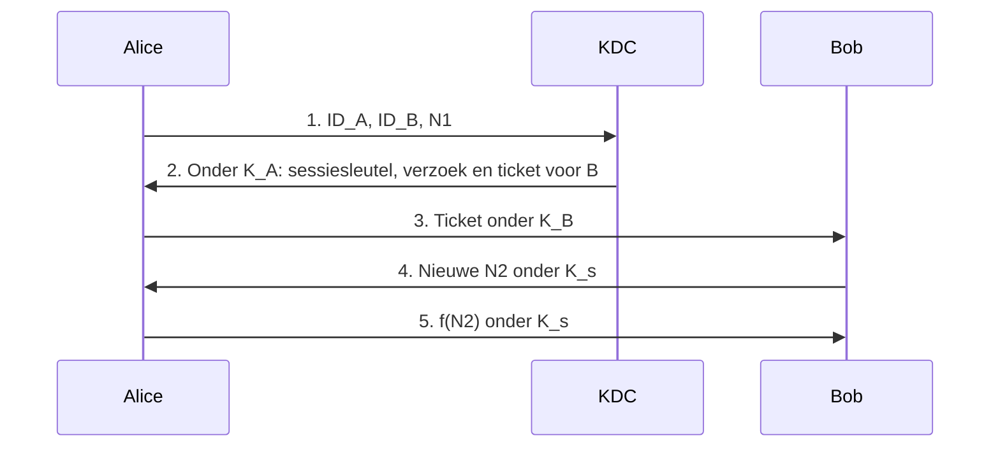

# Key Distribution — wie bezit welke sleutel?

**Studeerroute · Part 5, Mutual Trust.** Sleutelverdeling (pdf 3–22) → publieke directory en certificaten (23–41) → access control en wederzijdse authenticatie (42–49) → Kerberos v4/v5 en authenticatie met certificaten (50–61).

*Part 5: Mutual Trust* behandelt twee vragen. Hoe krijgen Alice en Bob een gedeeld geheim? En hoe weet Alice dat de publieke sleutel die ze gebruikt werkelijk bij Bob hoort? Phone Book draait om de tweede vraag.

## Een geheime sessiesleutel verdelen of afspreken

| Methode | Wat gebeurt er? | Bron (pdf-pagina) |
| --- | --- | --- |
| Vooraf gedeelde sleutels | Elk paar deelt een hoofdsleutel waarmee het een tijdelijke sessiesleutel kan beschermen. Voor n deelnemers en één hoofdsleutel per paar zijn er n(n−1)/2 hoofdsleutels. | 5–7 |
| Key Distribution Center | Alice en Bob delen elk een eigen hoofdsleutel met het KDC. Alice ontvangt de sessiesleutel en een voor Bob versleuteld ticket. Bob opent zijn ticket met zijn hoofdsleutel. Een nonce koppelt een antwoord aan het juiste verzoek. | 10–15 |
| Asymmetrisch sleuteltransport | De ene partij kiest de sessiesleutel en versleutelt hem met de publieke sleutel van de ontvanger. De afzender moet de binding tussen identiteit en publieke sleutel kunnen controleren. | 17–18 |
| Diffie–Hellman | Beide partijen combineren hun eigen geheime exponent met de publieke waarde van de andere partij. Voor zekerheid over de gesprekspartner is authenticatie van de uitwisseling nodig. | 19–22 |

## Diffie–Hellman: dezelfde formule in twee notaties

De cursus gebruikt q voor de priemmodulus en α voor de generator. De Phone Book-API noemt die waarden `p` en `g`. Onderstaande namen met A en B onderscheiden de deelnemers; de API heeft per directory-entry één veld `y`.

| Stap | Cursus | Met p en g uit de API |
| --- | --- | --- |
| Publieke waarde van A | Y_A = α^(X_A) mod q | y_A = g^(x_A) mod p |
| Publieke waarde van B | Y_B = α^(X_B) mod q | y_B = g^(x_B) mod p |
| A berekent de gedeelde sleutel | K = Y_B^(X_A) mod q | K = y_B^(x_A) mod p |
| B berekent de gedeelde sleutel | K = Y_A^(X_B) mod q | K = y_A^(x_B) mod p |

Beide kanten krijgen dezelfde waarde omdat (g^x_B)^x_A en (g^x_A)^x_B dezelfde exponent x_A·x_B hebben. Phone Book gebruikt **ElGamal** voor het bericht. Daar is één exponent tijdelijk en zit de bijbehorende publieke waarde in de ciphertext.

## Phone Book: ElGamal met de sleutel uit de directory

| Stap | Cursus (Part 4, slides 60–62) | In de oefening |
| --- | --- | --- |
| Sleutel van de ontvanger | Y_B = α^(X_B) mod q | `y = g^x mod p`. In je script heet x `chosen_private` en y `public_key`. |
| Afzender kiest verse k | C₁ = α^k mod q | c1 = g^k mod p |
| Afzender vormt de ciphertext | K = Y_B^k mod q, C₂ = K·M mod q | K = y^k mod p, c2 = K·m mod p |
| Bedoelde ontvanger ontsleutelt | K = C₁^(X_B) mod q, M = C₂·K⁻¹ mod q | K = c1^x mod p, m = c2·K⁻¹ mod p |

De JSON-naam `name` heeft geen algebraïsche tegenhanger. Het is de identiteitsclaim bij `y`. De wiskunde werkt met de gekozen sleutel; de directory bepaalt of de afzender die sleutel aan de juiste persoon koppelt.

## Vier methoden voor distributie van publieke sleutels

| Methode uit de slides | Hoe komt Alice aan Bobs sleutel? | Waarop vertrouwt ze? |
| --- | --- | --- |
| Public announcement | Bob publiceert de sleutel zelf. | De herkomst van de aankondiging moet apart vaststaan. |
| Publicly available directory | Alice zoekt Bob op in een beheerde lijst. | De beheerder verifieert wie onder Bobs naam mag registreren of wijzigen en beschermt de gepubliceerde lijst. |
| Public-key authority | Alice vraagt de sleutel op bij een online autoriteit. | Ze verifieert het geauthenticeerde antwoord, de gevraagde identiteit en de versheid ervan. |
| Public-key certificate | Alice ontvangt een certificaat dat de identiteit aan de sleutel bindt. | Ze controleert de handtekening van een vertrouwde uitgever, de identiteit en de geldigheid van het certificaat. |

Bron: *Part 5*, pdf-pagina’s 25–32. [Oefening 1 — Phone Book](01-Phone-Book/README.md)

## Sleutels, tickets en notatie · pdf 3–16

De titel *private key distribution* in dit deel slaat onder meer op het verdelen van een **geheime symmetrische sleutel**. De private helft van een asymmetrisch sleutelpaar blijft bij de eigenaar. Een master key beveiligt sleutelverdeling over langere tijd. Een session key dient één logische verbinding en beperkt hoeveel verkeer door het uitlekken van één sleutel geraakt wordt.

**Vier startmogelijkheden:** A kiest een sleutel en bezorgt die fysiek aan B; een vertrouwde derde kiest en levert aan beiden; A en B gebruiken een oude gedeelde sleutel om een nieuwe te vervoeren; of een derde gebruikt bestaande beveiligde verbindingen met A en B. Fysieke levering is lastig bij willekeurige paren op afstand. Versleuteling met een oude sleutel verplaatst het probleem naar de vraag hoe de eerste sleutel veilig aankwam.

In de protocoltabellen betekent E_K[X] bescherming van de velden X onder sleutel K zoals in het cursusmodel. ∥ is aaneenschakeling van ondubbelzinnig gecodeerde velden. ID_A is een identiteit, N een nonce, T een tijd of geldigheidsinterval. Een ticket is een door een vertrouwde partij opgesteld pakket voor een specifieke ontvanger. De partij die het doorstuurt hoeft het niet te kunnen openen.

```python
def aantal_hoofdsleutels(n):
    if n < 0:
        raise ValueError("Het aantal deelnemers moet positief of nul zijn.")
    paren = n * (n - 1) // 2
    return {"decentraal": paren, "centraal_met_een_KDC": n}

assert aantal_hoofdsleutels(20) == {"decentraal": 190, "centraal_met_een_KDC": 20}
```

**Decentraal, drie berichten.** (1) A vraagt B een sessiesleutel en stuurt N₁. (2) B kiest K_s en stuurt E_Km[K_s ∥ ID_B ∥ f(N₁) ∥ N₂]. A controleert de binding aan haar verzoek. (3) A stuurt E_Ks[f(N₂)]. B kan hieruit afleiden dat de andere partij de nieuwe sleutel bezit. Dit vergt een master key per paar.

**KDC met een master key per deelnemer.** K_A wordt gedeeld door A en het centrum, K_B door B en het centrum. De onderstaande figuur geeft de berichtvolgorde van pdf 12–13. De challenge-responsestappen gebruiken de nieuw uitgedeelde sleutel.



Het ticket is E_KB[K_s ∥ ID_A]. De nonce in bericht 2 helpt A het antwoord aan haar aanvraag te koppelen. Bericht 3 alleen bevestigt aan B nog niet dat de afzender nu K_s bezit. Dat bewijs volgt in bericht 5. In een hiërarchie behandelt het lokale KDC lokale paren. Twee verschillende lokale domeinen laten hun KDC’s via een hoger centrum coördineren. Dat spreidt beheer en belasting, terwijl de betrokken centra vertrouwd moeten blijven.

## Asymmetrisch sleuteltransport en DH · pdf 17–22

In het eenvoudige Merkle-schema stuurt A (ID_A, PU_A), kiest B een sessiesleutel en stuurt B E(PU_A, K_s). A berekent D(PR_A, E(PU_A, K_s)) = K_s. Het voorlopige sleutelpaar kan daarna weg. Als B geen zekerheid heeft over de herkomst van PU_A, ontbreekt de binding met A. Bij unauthenticated DH geldt dezelfde identiteitsvraag: overeenstemming over een geheim bewijst op zichzelf niet *met wie* dat geheim wordt gedeeld.

```python
# Twee eigen partijen; p en g zijn de JSON-namen voor cursus-q en α.
p, g = 23, 5
x_a, x_b = 6, 15
y_a, y_b = pow(g, x_a, p), pow(g, x_b, p)
k_a = pow(y_b, x_a, p)
k_b = pow(y_a, x_b, p)
assert (y_a, y_b, k_a, k_b) == (8, 19, 2, 2)
```

## Online autoriteit of certificaat? · pdf 23–41

Bij een **online public-key authority** kent iedereen de authentieke publieke sleutel van de autoriteit. A vraagt de huidige sleutel van B met een timestamp T₁. De autoriteit authenticeert haar antwoord met PU_B, het verzoek en T₁. A stuurt B haar identiteit en N₁ onder PU_B. B vraagt op zijn beurt de sleutel van A met T₂. Daarna bevestigen de partijen N₁ en N₂ onder elkaars publieke sleutels. De online autoriteit kan de actuele registratie melden, maar is nodig bij het opvragen van de sleutels.

Bij een **certificaat** kan de houder het ondertekende bewijs zelf doorgeven. De cursus schrijft symbolisch C_A = E(PR_auth, [T ∥ ID_A ∥ PU_A]). In hedendaagse handtekeningnotatie is dat een leesbare inhoud met een CA-handtekening erover. Iedereen moet (1) naam en sleutel kunnen lezen, (2) de uitgever en integriteit kunnen controleren, (3) alleen door die uitgever geautoriseerde wijzigingen accepteren en (4) tijdsgeldigheid kunnen controleren. De CA controleert de identiteit bij uitgifte. De directory kan het certificaat vervolgens publiek beschikbaar maken.

### X.509 en een keten van vertrouwen

X.509 levert een certificaatformaat en een raamwerk voor authenticatie, onder andere bij TLS, IPsec en S/MIME. De CA ondertekent de te ondertekenen certificaatvelden als één gecodeerde structuur. Het schema en de hash worden geïdentificeerd in het certificaat. Behandel de edities van de X.509-aanbeveling en het **versieveld in een certificaat** als twee verschillende nummers. Het college bespreekt de evolutie van v1 (1988) via v2 naar het uitbreidbare v3-formaat.

| Veld | Waarvoor controleer je het? |
| --- | --- |
| Versie, serienummer | Het serienummer identificeert een certificaat binnen één uitgever. V2 introduceerde optionele unieke identifiers, v3 extensies. |
| Issuer en subject | De uitgever doet een uitspraak over de houder. Een leesbare naam op zichzelf bewijst de identiteit nog niet. |
| Geldigheidsperiode | Het controletijdstip moet tussen het begin en einde van de geldigheid vallen. |
| Subject Public Key Info | De publieke sleutel plus algoritme en parameters horen bij de gecertificeerde houder. |
| Algoritme en handtekening | Verifieer de handtekening over de TBS-inhoud met de authentieke sleutel van de issuer. |
| Extensies | Onder meer CA-bevoegdheid, toegelaten sleutelgebruik en alternatieve namen bepalen waarvoor de sleutel bruikbaar is. |

In de notatie Y⟪X⟫ ondertekent Y het certificaat van X. Vertrouwt C al op X, dan kan C in de slidevoorstelling X⟪W⟫ → W⟪V⟫ → V⟪Y⟫ → Y⟪Z⟫ → Z⟪B⟫ volgen. Elk geldig tussenstapje levert de sleutel voor de volgende controle. Het pad begint bij een vooraf vertrouwde sleutel. Cross-certificering kan beide richtingen omvatten. Vanuit CA X is W⟪X⟫ een *forward certificate* van X en X⟪W⟫ een *reverse certificate* in de terminologie van de slides.

Een certificaat kan vóór zijn einddatum worden ingetrokken omdat de privésleutel mogelijk gelekt is, de houder niet langer gecertificeerd is of de CA gecompromitteerd is. Een **CRL** bevat ingetrokken certificaten van die issuer, geïdentificeerd via hun serienummers, en wordt ondertekend en periodiek vernieuwd. Controleer dus behalve de tijd ook de intrekkingsinformatie en de geldigheid van de keten.

```python
from datetime import datetime, timezone

def status_binnen_issuer(serienummer, start, einde, nu, ingetrokken):
    """Tijd- en intrekkingsstap, nadat issuer en CRL zijn geauthenticeerd."""
    if not start <= nu <= einde:
        return "buiten geldigheidsperiode"
    if serienummer in ingetrokken:
        return "ingetrokken"
    return "tijd en intrekkingscontrole geslaagd"

def utc(jaar):
    return datetime(jaar, 1, 1, tzinfo=timezone.utc)

assert status_binnen_issuer(12, utc(2025), utc(2028), utc(2026), {12}) == "ingetrokken"
assert status_binnen_issuer(13, utc(2025), utc(2028), utc(2029), set()) == "buiten geldigheidsperiode"
```

## User management en wederzijdse authenticatie · pdf 42–49

**Identificatie** is de claim ‘ik ben Alice’. **Authenticatie** verifieert die claim. **Autorisatie** bepaalt of die geauthenticeerde identiteit een specifieke actie op een object mag uitvoeren. Access control dwingt het besluit af. Dit onderscheid verklaart Phone Book: zelfs een correct geregistreerde ontvanger mag niet automatisch elk geheim ontvangen.

| Authenticatiefactor | Voorbeeld |
| --- | --- |
| Kennis | Wachtwoord of pincode |
| Bezit | Smartcard, sleutel of tokengenerator |
| Eigenschap | Vingerafdruk, iris of gezicht |
| Gedrag | Typ- of schrijfritme |

MFA combineert onafhankelijke factortypes. Twee antwoorden die iemand moet kennen tellen beide als kennis. Wederzijdse authenticatie vraagt dat beide kanten bewijs over de andere kant krijgen. Geheimhouding beschermt de sessiesleutel; **versheid** helpt een oude uitwisseling te onderscheiden van een huidige.

| Mechanisme | Wat moet de ontvanger bijhouden? | Kost of beperking |
| --- | --- | --- |
| Volgnummer | Laatste geaccepteerde nummer per relatie | Toestand bewaren en omgaan met herordening |
| Timestamp | Klok, acceptatievenster en waar nodig replaycache | Klokken moeten voldoende gelijk lopen; binnen het venster blijft dubbele aanbieding mogelijk |
| Nonce/challenge | Openstaande, unieke uitdaging die na gebruik vervalt | Extra berichtuitwisseling; in éénrichtingsverkeer niet vanzelf beschikbaar |

### Waarom een oud ticket een apart probleem is

In het eerste KDC-protocol toont het antwoord op N₂ kennis van K_s. Als een oude sessiesleutel inmiddels gecompromitteerd is, bewijst kennis ervan geen huidige legitimiteit. B heeft informatie nodig waaruit blijkt dat het ticket *voor deze uitwisseling*, of nog binnen een door B vertrouwde geldigheidsduur, is uitgegeven.

| Stap in de variant op pdf 48 | Bericht en bedoeling |
| --- | --- |
| A → B | ID_A ∥ N_A. A kiest vers N_A. |
| B → KDC | ID_B ∥ N_B ∥ E_KB[ID_A ∥ N_A ∥ T_B]. B kiest zijn uitdaging en eigen tijdsgrens. |
| KDC → A | E_KA[ID_B ∥ N_A ∥ K_s ∥ T_B], het ticket E_KB[ID_A ∥ K_s ∥ T_B] en N_B. A controleert N_A. |
| A → B | A stuurt het ticket en E_Ks[N_B]. B kan zijn eigen tijdsgrens en challenge controleren. |

**Nieuwe sessie zonder opnieuw het KDC te benaderen** (pdf 49). Zolang T_B geldig is: A → B stuurt ticket en N′_A. B → A stuurt N′_B en E_Ks[N′_A]. A → B stuurt E_Ks[N′_B]. De nieuwe challenges binden de uitwisseling aan dit moment. B beoordeelt de levensduur met zijn eigen klok.

```python
from secrets import token_bytes

openstaand = set()

def nieuwe_challenge():
    nonce = token_bytes(32)
    openstaand.add(nonce)
    return nonce

def consumeer_na_authenticatie(nonce):
    """Eenmalig gebruik in dit lokale model; de respons is vooraf geauthenticeerd."""
    if nonce not in openstaand:
        return False
    openstaand.remove(nonce)
    return True

n = nieuwe_challenge()
assert consumeer_na_authenticatie(n)
assert not consumeer_na_authenticatie(n)
```

## Kerberos · pdf 50–59

**Rollen.** De client C wil een dienst op server V gebruiken. De Authentication Server (AS) levert toegang tot de Ticket-Granting Server (TGS). De TGS geeft een ticket voor V. De AS en de TGS behoren tot het vertrouwde KDC van een *realm*. C hoeft het wachtwoord daardoor niet aan iedere applicatieserver te tonen. Kerberos gebruikt gedeelde sleutels, versheid en tijdsvensters; de dienst beslist daarna welke handelingen toegestaan zijn.

| Object | Wie kan het openen? | Wat bewijst of levert het? |
| --- | --- | --- |
| Ticket-granting ticket (TGT) | TGS met zijn langetermijnsleutel | Identiteit van C, geldigheid en de sessiesleutel K_c,tgs |
| Service ticket voor V | V met zijn langetermijnsleutel | Identiteit van C, geldigheid en de sessiesleutel K_c,v |
| Authenticator | TGS of V met de toepasselijke sessiesleutel | C heeft die sleutel en presenteert een verse identiteit/timestamp |
| Antwoord voor C | C met de sleutel die al bij die fase hoort | C ontvangt zijn eigen kopie van de nieuwe sessiesleutel |

### De zes berichten van v4

1. **C → AS:** ID_C, ID_TGS en TS₁. C vraagt een TGT.
2. **AS → C:** onder K_C ontvangt C K_c,tgs, de TGS-identiteit, TS₂, levensduur en het TGT. Binnen het TGT zitten onder K_TGS dezelfde sessiesleutel, identiteit en adres van C, TGS-identiteit en tijden.
3. **C → TGS:** ID_V, TGT en een verse authenticator onder K_c,tgs met ID_C, adres en TS₃.
4. **TGS → C:** onder K_c,tgs ontvangt C K_c,v, ID_V, TS₄ en het service ticket. Dat ticket is intern onder K_V beschermd.
5. **C → V:** service ticket en een nieuwe authenticator onder K_c,v met TS₅.
6. **V → C:** voor wederzijdse authenticatie antwoordt V met E_Kc,v[TS₅+1]. Zo koppelt C de reactie aan zijn eigen verzoek.

Het TGT kan tijdens de geldigheid meerdere service tickets opleveren; een authenticator is voor één presentatie. Een ticket alleen toont dus niet dat de aanbieder op dit moment de bijbehorende sessiesleutel heeft.

### Realms en v5

Voor een dienst in een ander realm vraagt C eerst lokaal een TGT. De lokale TGS levert vervolgens een ticket voor de buitenlandse TGS plus de bijbehorende sessiesleutel. Daarmee vraagt C bij die TGS het buitenlandse service ticket en biedt dat aan de dienst aan. Iedere nieuwe presentatie gebruikt een bij de ontvanger passende authenticator. Volledig paarsgewijs vertrouwen tussen N realms vraagt N(N−1)/2 relaties. Een vertrouwenspad kan de noodzaak van een rechtstreeks paar tussen alle realms verminderen.

| Onderdeel | Verschillen die de slides bij v5 benadrukken |
| --- | --- |
| Platform en codering | Ondersteuning voor meerdere encryptietypes en adrestypes, expliciete gestructureerde ASN.1-codering en ondubbelzinnige bytevolgorde. De slides noemen BER; voor Kerberos v5 op de draad specificeert RFC 4120 DER. |
| Tickets | Expliciete start- en eindtijden, opties voor verlengen en doorsturen, flexibeler inter-realm vertrouwen. De beperkte v4-levensduur is op de slides ongeveer 21 uur. |
| Technische wijzigingen | Het ticket wordt apart van de versleutelde clientvelden verstuurd. Algoritmekeuze en integriteitsbescherming vervangen de vaste v4-constructie met DES-PCBC. Een subkey kan één verbinding afbakenen. Pre-authenticatie vraagt al bij de AS bewijs van sleutelbezit. |
| AS exchange | Aanvraag met opties, ID_C, realm, ID_TGS, gewenste tijden en N₁. Antwoord bevat TGT én onder K_C de sessiesleutel, tijden, N₁ en de TGS-gegevens. C matcht de nonce. |
| TGS exchange | Aanvraag met opties, gewenste dienst, tijden, N₂, TGT en authenticator. Antwoord bevat het service ticket én onder K_c,tgs de nieuwe sleutel, tijden, N₂ en de dienst-/realminformatie. |
| Application exchange | C stuurt opties, service ticket en authenticator onder K_c,v. Bij gevraagde wederzijdse authenticatie bevestigt V de timestamp. Een subkey en een volgnummer kunnen bij de verbinding horen. |

## Wederzijdse authenticatie met certificaten · pdf 60–61

Het laatste protocol combineert publieke sleutels, een KDC en twee challenges. Lees bij ieder bericht **wie de inhoud mag lezen**, **wie ervoor instaat** en **welke nonce de inhoud vers maakt**.

1. A vraagt het KDC om de sleutel van B. Het KDC certificeert de binding ID_B ↔ PU_B.
2. A stuurt ID_A en een geheime N_A versleuteld voor B. B vraagt het KDC om A’s certificaat en een sessiesleutel; het beschermt N_A voor het KDC.
3. Het KDC geeft B A’s certificaat en een voor B versleutelde, door het KDC ondertekende verklaring over (N_A, K_s, ID_A, ID_B).
4. B stuurt die verklaring en een verse N_B versleuteld voor A. A controleert afzender, identiteiten en eigen N_A. Met E_Ks[N_B] bewijst A tenslotte aan B dat ze K_s heeft.

Dat zijn de zeven pijlen van slide 66, hier gegroepeerd per verzoek en antwoord. De certificaten binden namen aan sleutels; de challenges en de ondertekende sessiegegevens binden deze sleuteluitwisseling aan A en B.

## Van protocolpijl naar formule · pdf 51–60

Onderstaande uitwerking gebruikt C voor de client, V voor de dienst en R voor een realm. Bij v5 staat T voor de aangevraagde of toegekende tijden en Opt voor opties. De cursus laat soms optionele velden weg. Lees een buitenste ticket en een voor de client versleuteld veld als twee afzonderlijke onderdelen.

| Kerberos v5 | Compacte cursusvorm | Welke controle doet de ontvanger? |
| --- | --- | --- |
| 1. AS-REQ | C → AS: Opt ∥ ID_C ∥ R_C ∥ ID_TGS ∥ T ∥ N₁ | Identiteit en opties vormen de aanvraag. Waar vereist bewijst de client sleutelbezit met pre-authenticatie. |
| 2. AS-REP | AS → C: R_C ∥ ID_C ∥ TGT ∥ E_KC[K_c,tgs ∥ T ∥ N₁ ∥ R_TGS ∥ ID_TGS] | C vergelijkt N₁ en de gevraagde TGS. Het TGT is voor de TGS versleuteld. |
| 3. TGS-REQ | C → TGS: Opt ∥ ID_V ∥ T ∥ N₂ ∥ TGT ∥ Auth_c,tgs | TGS opent het TGT en valideert de verse authenticator met K_c,tgs. |
| 4. TGS-REP | TGS → C: R_C ∥ ID_C ∥ Ticket_V ∥ E_Kc,tgs[K_c,v ∥ T ∥ N₂ ∥ R_V ∥ ID_V] | C matcht N₂ en de dienst. Ticket_V is beschermd met K_V. |
| 5. AP-REQ | C → V: Opt ∥ Ticket_V ∥ Auth_c,v | V opent zijn ticket, controleert de authenticator en geldigheid. |
| 6. AP-REP | V → C: E_Kc,v[TS uit authenticator ∥ optionele subkey ∥ optioneel volgnummer] | C herkent zijn eigen verse tijdstip. Dit bericht hoort bij wederzijdse authenticatie. |

**Wat staat er binnenin?** In de vereenvoudigde v5-slidenotatie is Ticket_V = E_KV[Flags ∥ K_c,v ∥ R_C ∥ ID_C ∥ AD_C ∥ T]. Auth_c,v = E_Kc,v[ID_C ∥ R_C ∥ TS₂]. De langetermijnsleutel K_V beschermt het ticket. De tijdelijke sleutel K_c,v beschermt het bewijs uit de huidige sessie. In v4 wordt TS₅+1 teruggestuurd; v5 bevestigt het tijdstip uit de authenticator.

Voor slide 66 kun je de certificatenuitwisseling ook in de compacte notatie opschrijven. Sign_K betekent een verklaring met handtekening, controleerbaar met de publieke tegenhanger.

| Pijl | Inhoud |
| --- | --- |
| A → KDC | ID_A ∥ ID_B |
| KDC → A | Sign_PRKDC(ID_B ∥ PU_B) |
| A → B | E_PUB[N_A ∥ ID_A] |
| B → KDC | ID_A ∥ ID_B ∥ E_PUKDC[N_A] |
| KDC → B | Cert_A ∥ E_PUB[verklaring], met verklaring = Sign_PRKDC(N_A ∥ K_s ∥ ID_A ∥ ID_B) |
| B → A | E_PUA[N_B ∥ verklaring] |
| A → B | E_Ks[N_B] |

### Een X.509-keten controleren vanuit Python

Dit blok maakt een tijdelijke eigen cursus-CA en een dienstcertificaat. De bibliotheek achter OpenSSL controleert de handtekening, het pad, de geldigheidsduur en de gevraagde servernaam. De tweede controle gebruikt bewust een andere naam. De eerdere CRL-snippet behandelt de aparte intrekkingsstap. Dit voorbeeld heeft de lokale OpenSSL-opdracht nodig en maakt geen netwerkverbinding.

```python
from pathlib import Path
from subprocess import run
from tempfile import TemporaryDirectory

with TemporaryDirectory() as mapnaam:
    def openssl(*args, vereist=True):
        return run(["openssl", *args], cwd=mapnaam, capture_output=True, check=vereist)

    openssl("req", "-x509", "-newkey", "rsa:2048", "-nodes", "-days", "2",
            "-subj", "/CN=Cursus CA", "-keyout", "ca.key", "-out", "ca.pem",
            "-addext", "basicConstraints=critical,CA:TRUE",
            "-addext", "keyUsage=critical,keyCertSign,cRLSign")
    openssl("req", "-newkey", "rsa:2048", "-nodes", "-subj", "/CN=college.test",
            "-keyout", "dienst.key", "-out", "dienst.csr")
    Path(mapnaam, "ext.txt").write_text(
        "basicConstraints=critical,CA:FALSE\n"
        "subjectAltName=DNS:college.test\n"
        "extendedKeyUsage=serverAuth\n", encoding="ascii")
    openssl("x509", "-req", "-in", "dienst.csr", "-CA", "ca.pem", "-CAkey", "ca.key",
            "-set_serial", "42", "-days", "1", "-extfile", "ext.txt", "-out", "dienst.pem")
    def controleer(naam):
        return openssl("verify", "-CAfile", "ca.pem", "-purpose", "sslserver",
                       "-verify_hostname", naam, "dienst.pem", vereist=False).returncode == 0

    assert controleer("college.test")
    assert not controleer("andere.test")
```

### Modelleer welk Kerberos-bewijs bij welke ontvanger hoort

Met onderstaande functie kun je de logica van ticket en authenticator inoefenen. De parameters stellen **reeds cryptografisch geverifieerde** gegevens voor. De functie controleert de identiteit, de dienst, het geldigheidsvenster, de klokafwijking en dubbel gebruik in een lokale oefencache. Ze bouwt geen Kerberos-netwerkberichten.

```python
from dataclasses import dataclass

@dataclass(frozen=True)
class Ticket:
    client: str
    dienst: str
    start: int
    einde: int

def accepteer(ticket, dienst, client, tijdstempel, nu, cache, klokmarge=5):
    if ticket.dienst != dienst or ticket.client != client:
        return False
    if not ticket.start <= nu < ticket.einde or abs(nu - tijdstempel) > klokmarge:
        return False
    kenmerk = (dienst, client, tijdstempel)
    if kenmerk in cache:
        return False
    cache.add(kenmerk)
    return True

ticket = Ticket("alice", "printer", 100, 200)
gezien = set()
assert not accepteer(ticket, "archief", "alice", 120, 121, gezien)
assert accepteer(ticket, "printer", "alice", 120, 121, gezien)
assert not accepteer(ticket, "printer", "alice", 120, 122, gezien)
assert not accepteer(ticket, "printer", "alice", 201, 201, gezien)
```

[Kerberos v5 (RFC 4120)](https://www.rfc-editor.org/rfc/rfc4120) · [X.509 en CRL’s (RFC 5280)](https://www.rfc-editor.org/rfc/rfc5280)
